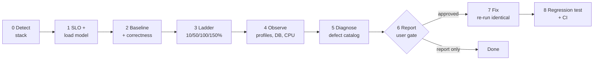

<div align="center">

# 🎯 highload-hunt

**A skill that makes AI coding agents prove performance under load — instead of guessing.**

[](LICENSE)
[](#-install)
[](#-design-principles)
[](#-hard-gates)

</div>

---

AI agents are very good at saying *"I optimized the endpoint, it should be much faster now."*
They are much worse at proving it. `highload-hunt` turns that sentence into a measured verdict:

```
p95  183 ms  ->  92 ms      (target <= 200 ms)
rps  301     ->  318        (target >= 300)
errors 0.20% ->  0.00%      (target <= 0.5%)
```

No baseline, no number, no finding. No reproducer, no fix. No re-run, no claim.

## 🧠 What it does

The skill drives an agent through a fixed protocol: detect the stack, define an SLO, seed production-like data, ramp load in a ladder, find the breaking point, diagnose with profiles and query plans, then write a report. Production code changes only after you approve that report.

It writes **explicit, committed E2E performance tests** — not throwaway scripts in `/tmp`. Tests start the real service, seed deterministic data, generate load at a fixed arrival rate, assert p95/p99/error/throughput bounds, and fail the build on violation.



## 🚧 Hard gates

The whole point is what the agent is **not allowed** to do.

| Gate | Rule |
|:----:|------|
| **G1** | No verdict without baseline + load + repeat runs |
| **G2** | Load tests live in `tests/perf/` in the repo, not `/tmp` |
| **G3** | Every finding has a reproducer, a metric, and a mechanism |
| **G4** | Report first, code second — fixes need your explicit approval |
| **G5** | A fix is proven by an identical re-run: same seed, rate, dataset |
| **G6** | Forbidden shortcuts: `sleep` as throttle, mocked DB, p95 from 10 samples, one-run comparisons, SLO moved mid-hunt |
| **G7** | Exit is *SLO met* or *accepted risk* — never "looks fine" |
| **G8** | Every fixed defect leaves a regression test that fails on the old code |

> A perf test that passes because it never checked the response body is worse than no test.
> Correctness is asserted under load, not just status codes.

## 📦 What you get

```
tests/perf/
├── README.md                  # how to run each test
├── thresholds.ts              # one source of truth for the SLO
├── seed.ts                    # deterministic dataset, fixed seed
├── api.items.load.test.ts     # HTTP load at fixed arrival rate
├── db.items.concurrency.test.ts
├── journey.checkout.e2e.spec.ts
└── results/                   # raw JSON artifacts, gitignored
PERF-REPORT.md                 # verdict, metrics, ranked findings
```

Each finding in the report looks like this:

> **F1: list endpoint does N+1 queries per item**
> Reproducer: `tests/perf/api.items.load.test.ts` — `npm run perf:items`
> Metric: p95 640 ms → 210 ms expected at 300 rps; DB calls 41 per request
> Evidence: `pg_stat_statements` top query, 54k calls in the 100% run
> Mechanism: serializer awaits `item.owner` inside a `for` loop
> Fix direction: prefetch owners with one `IN (...)` query

## 🚀 Install

Clone once, link into every harness you use. Symlink mode means `git pull` updates all of them.

```bash
git clone https://github.com/Yarfer800/highload-hunt.git
cd highload-hunt
./install.sh --list        # see detected harnesses and target paths
```

| Harness | Command | Target |
|---------|---------|--------|
| **Claude Code** | `./install.sh --host claude` | `~/.claude/skills/highload-hunt` |
| **Codex** | `./install.sh --host codex` | `~/.codex/skills/highload-hunt` |
| **DeepSeek Harness** | `./install.sh --host dsh` | `~/.dsh/skills/highload-hunt` |
| **OpenCode / ECC** | `./install.sh --host opencode` | `~/.config/opencode/skills/highload-hunt` |
| **Cross-host** | `./install.sh --host agents` | `~/.agents/skills/highload-hunt` |
| **Antigravity / Gemini** | `./install.sh --all` | `~/.antigravity/skills`, `~/.gemini/skills` + `AGENTS.md` snippet |
| **This repo only** | `./install.sh --project .` | `./.agents/skills/highload-hunt` + `./.claude/skills/highload-hunt` |

Other flags: `--mode copy` (no symlink), `--force` (replace existing), `--dry-run`, `--uninstall`, `--no-commands`.

The installer also wires a slash command where the harness supports custom commands: **Claude Code** (`~/.claude/commands`), **Codex** (`~/.codex/prompts`), **OpenCode** (`~/.config/opencode/commands`). Harnesses that read `AGENTS.md` instead of a skills directory get a ready block printed by the installer:

```markdown
## Highload performance hunts
When asked to load-test, stress-test, benchmark, or explain slowness under
traffic, read ~/.agents/skills/highload-hunt/SKILL.md and follow its phases
and hard gates. Report first; do not change production code before approval.
```

## ⌨️ Slash command

Installed next to the skill where supported (`/highload-hunt`):

```
/highload-hunt GET /api/items --rps 300 --slo-p95 200 --slo-p99 500
/highload-hunt --tier S --report-only
/highload-hunt checkout flow, 500 concurrent users
```

Arguments are freeform: the command loads `SKILL.md`, runs preflight, then the protocol. With no arguments it treats the project as the target and asks for the production peak rate and latency expectations.

| Harness | Command file | Invocation |
|---------|--------------|------------|
| Claude Code | `~/.claude/commands/highload-hunt.md` | `/highload-hunt` |
| Codex | `~/.codex/prompts/highload-hunt.md` | `/highload-hunt` |
| OpenCode | `~/.config/opencode/commands/highload-hunt.md` | `/highload-hunt` |
| DSH, Antigravity, Gemini | skill only | natural language trigger |

## ⚡ Quick start

Once installed, just ask. The skill triggers on the intent, not on a magic command.

> **You:** Why does `GET /api/items` stall at around 200 rps? Load-test it properly and find the bottleneck.

Then the agent:

```bash
bash scripts/perf-doctor.sh .          # facts, not guesses
k6 run --summary-export=results/100pct.json tests/perf/k6/items.js
bash scripts/slo-gate.sh --file results/100pct.json \
     --p95 200 --p99 500 --err 0.5 --rps 300
py-spy record -o profile.svg --pid <pid> --duration 30
```

...and returns `PERF-REPORT.md` with a verdict, not adjectives.

Gate a run by hand at any time:

```bash
$ bash scripts/slo-gate.sh --file results/k6-100pct.json --p95 200 --p99 500 --err 0.5 --rps 300
slo-gate: results/k6-100pct.json
  metric       measured       threshold    verdict
  p95          183.4ms        200ms        PASS
  p99          402.1ms        500ms        PASS
  error rate   0.2%           0.5%         PASS
  rps          301.2          300          PASS
dropped iters  0              0            PASS
slo-gate: PASS
```

It also fails the run when the **generator** becomes the bottleneck (`dropped_iterations > 0`) or when there are too few samples for the percentile — the two most common sources of fake good news.

## 🗂️ What's inside

| Path | Purpose |
|------|---------|
| `SKILL.md` | The protocol: 8 phases, tiers S/M/L, hard gates, exit criteria |
| `references/load-model.md` | Open vs closed model, Little's law, SLO math, statistics, measurement traps |
| `references/generators.md` | k6, locust, autocannon, wrk/wrk2, vegeta, ghz, queue load |
| `references/in-process-load.md` | Concurrency tests for Node, Python, Go, JVM: pools, stampede, leaks, locks |
| `references/e2e-test-anatomy.md` | How to write the explicit perf E2E test and wire it into CI |
| `references/defect-catalog.md` | 32 symptom → mechanism → fix rows: N+1, missing index, pool exhaustion, stampede, lock convoy, retry storm, leaks |
| `references/profiling.md` | py-spy, 0x/`--cpu-prof`, pprof, async-profiler, `pg_stat_statements`, locks, cgroups |
| `references/stack-detection.md` | Manifest → stack → runner → entry point, monorepo rules |
| `references/report-template.md` | The report skeleton the agent must fill |
| `templates/` | k6 scenario, locust journey, Node/Python/Go concurrency tests |
| `commands/highload-hunt.md` | `/highload-hunt` launcher for Claude Code, Codex, OpenCode |
| `scripts/perf-doctor.sh` | Read-only preflight: stack, run command, datastore, generators, CI, hardware |
| `scripts/slo-gate.sh` | Result JSON → PASS/FAIL exit code for CI |

## 🧩 Supported stacks and tools

**Stacks:** Node/TypeScript (Next.js, NestJS, Express, Fastify), Python (FastAPI, Django, Flask), Go, JVM, Rust, PHP, .NET.
The agent detects the manifest and picks the matching runner, profiler, and query stats tool.

**Load:** k6 (default for HTTP SLOs), locust (Python journeys), autocannon (30-second sanity), wrk2 (coordinated-omission-correct tails), vegeta (constant-rate soak), ghz (gRPC), plus direct broker load for workers.

**Test runners:** vitest/jest/Playwright, pytest, `go test -tags perf`, JUnit/JMH. All perf tests are tagged so normal CI stays fast.

## 🎚️ Tiers

Not every question needs a two-day hunt.

| Tier | Scope | Time box |
|:----:|-------|----------|
| **S** | One endpoint or query | 30–60 min |
| **M** | One service, realistic read/write mix | 2–4 h |
| **L** | Multi-service journey, release gate, soak + spike | 1–2 days |

Gates apply at every tier. A Tier S hunt still produces numbers, a test, and a verdict.

## 💡 Design principles

1. **Evidence over vibes.** A latency claim without a sample count is a guess.
2. **The test is the artifact.** A fix that leaves no regression test will regress.
3. **Measure the knee, not just pass/fail.** Passing at 300 rps with a knee at 310 rps is fragile, and the report says so.
4. **Realism beats volume.** Production-like data cardinality exposes the missing index; 10k rows do not.
5. **Report before rewrite.** The user decides what gets changed, with the cost in front of them.
6. **Zero runtime dependencies.** Bash, a JSON parser, and whichever generator the project already trusts.

## ❓ FAQ

**Does it need k6 installed?**
No. It picks from what is available (`k6`, `locust`, `autocannon`, `wrk`, `vegeta`, `ab`) and says which one it used. `slo-gate.sh` needs only `bash` and `python3`.

**Is there a slash command?**
Yes, `/highload-hunt` for Claude Code, Codex, and OpenCode. It is a thin launcher: it loads the skill, runs preflight, and then follows the protocol. Other harnesses trigger the skill from natural language.

**Will it load-test production?**
The protocol targets a local or staging environment. Pointing a generator at production is a separate decision with its own approval, and the skill requires you to say so explicitly.

**Does it change my code automatically?**
No. Default output is `PERF-REPORT.md` plus tests. Fixes happen only after you approve the findings (Gate G4), then each fix is proven by an identical re-run.

**What if the service cannot be started or measured?**
The hunt ends `BLOCKED` with the exact missing piece. The skill forbids inventing numbers.

**Is this a benchmark framework?**
It is a protocol that tells an agent how to use one correctly — and a few scripts that keep it honest.

## 🤝 Contributing

Issues and PRs welcome: new defect-catalog entries with a real reproducer, new stack detection rows, additional generator templat